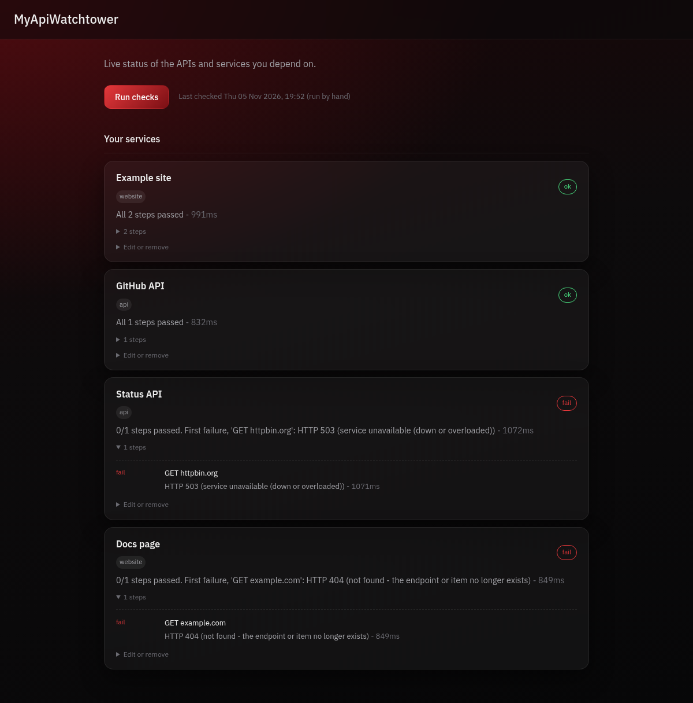

<div align="center">

# MyApiWatchtower

**A self-hosted dashboard that live-tests the APIs and services you depend on, so a breaking change gets noticed before someone else has to report it.**

[](https://www.python.org/)
[](https://flask.palletsprojects.com/)
[](LICENSE)

</div>



---

## What it does

A fresh install watches nothing. You add the services you care about from the page - any HTTP or HTTPS endpoint - and MyApiWatchtower checks them on demand or once a day:

- **Name, method and URL** (`GET`, `HEAD` or `POST`).
- **What counts as up**: a status code or ranges like `200-299, 301`. The default is `200-399`.
- **Optional text the response must contain**, e.g. `"status":"ok"`, so a page that answers but is broken still fails.
- **One optional secret header**, e.g. `Authorization: Bearer ...`, for APIs that need a key. It's sent with the request but never shown on the page, and it's scrubbed from any error message.
- **Timeout and tags**: tags show on the row, so you can see what a failure affects.

Each service can be edited or removed from its row. Saving or adding a service checks it straight away.

When `DISCORD_ALERT_WEBHOOK_URL` is set, a full run posts to that Discord webhook whenever a service starts failing or comes back, and stays quiet otherwise.

The results page is public and read-only. Running checks and adding, editing or removing services all need a sign-in: the app's own owner account by default (see [First run and sign-in](#first-run-and-sign-in)), or HTTP Basic Auth when `WEB_USERNAME`/`WEB_PASSWORD` are set.

## Plugins: deeper checks in Python

For checks that need more than one request - log in, then search, then download a file, checking the fields your code reads at each step - drop a Python file into a `plugins/` folder next to `app.py` (git-ignored, so your own checks never end up in this repo). Each plugin file can define:

- `CHECKS`: a list of `{"id", "label", "projects", "kind", "run"}` dicts. `kind` picks the section (`api`, `scraper` or anything else), and `run()` returns a `checks.result.CheckResult`. The `checks.probe.Probe` helper records each step with its own result and timing.
- `credentials` on a check (optional): a list of `{"env", "label", "secret"}` fields, plus `"url": True, "default": ...` for an editable API link. These get an **Edit** panel on the page; read them with `os.environ` or `checks.settings.configured_url`.
- `notes()` (optional): lines to show at the top of the page.
- `setup(app)` (optional): called once at startup, e.g. to add an OAuth callback route.

A plugin that fails to import stops the app with the plugin's name and the error, rather than silently dropping its checks.

---

## Setup

```bash
pip install -r requirements.txt
cp .env.example .env
python app.py
```

Open `http://127.0.0.1:5002`, click **Sign in to edit**, make the owner account (below) and use **Add a service**. Services are saved to `services.json` next to `app.py` (owner-only permissions, git-ignored).

The status rows are public, but the edit panels (which show each service's URL and the plugin API links) only render for a signed-in viewer, so anyone who can reach the page sees names and statuses, not where things live.

### First run and sign-in

MyApiWatchtower has its own sign-in, switched on by default (see "Other ways to sign in" below for the
alternatives). There is one owner account and no sign-up page. The status rows stay public; the owner account is
what runs checks and edits services and credentials.

1. Start it (`python app.py`) and open `http://127.0.0.1:5002`, then **Sign in to edit**. With no account yet that
   goes to **Set up**.
2. The app writes a one-time setup code to its log when it starts, a line like
   `no owner account yet: open /setup and enter the setup code ...`. Enter that code, a user name and a password
   (10 characters or more, twice). The code stops anyone else who reaches the page first from making the account,
   and it works once: if the owner file is ever deleted, the next visit to **Set up** writes a new code to the log.
3. After that, **Sign in to edit** goes to **Sign in**. A session lasts 30 days. **Sign out** (`/signout`) signs out
   on every device.

How it is protected:

- The password is stored as an scrypt hash in `owner.json` next to `app.py` (mode 600, git-ignored), never in plain
  text.
- 5 wrong passwords or setup codes from one address within 15 minutes lock that address out for the rest of the 15
  minutes (`429`). Attempts sent at once are counted before they are checked, IPv6 addresses count by their `/64`
  network, and after 100 failures from everywhere within 15 minutes each address gets one try and each network
  three (IPv4 by `/24`, IPv6 by `/48`). A right password from a locked address is refused too.
- During such an attack one wrong password from a neighbour on the same provider network does not keep your new
  browser out: that takes three wrong passwords within 15 minutes from three of their addresses (IPv4) or three of
  their home lines (IPv6, where a line's whole `/56` counts as one address).
- A browser that has signed in before keeps a signed device cookie and has its own 5 tries, so a stranger who locks
  out your address (or the address of the proxy in front) cannot lock you out of that browser. During an attack from
  many networks that browser is the way in. Making a new owner account ends every device cookie of the old one.
- The session cookie is `HttpOnly`, `SameSite=Lax` and signed with the app's secret key (`SECRET_KEY`, or
  `secret_key` next to `app.py`, made on first start, mode 600). It is `Secure` everywhere except plain `http` on
  `localhost`, `127.0.0.1` or `[::1]` (`SECURE_COOKIES=auto`). On a plain `http` address on your home network the
  browser drops a `Secure` cookie and the sign-in page says so: use https, or set `SECURE_COOKIES=false` there.
- Forget the password? Stop the app, delete `owner.json` next to `app.py`, start it again and set up a new owner
  with the new setup code from the log. Services, credentials and results stay.

Behind a reverse proxy for https, with the own sign-in still on: list the proxy's address in `TRUSTED_PROXIES` so
the lockout counts each visitor's address from `X-Forwarded-For` instead of the proxy's (the header is read only from
those addresses), and put the public host name in `ALLOWED_HOSTS`. By default the own sign-in answers only on
`localhost`, `127.0.0.1`, `[::1]`, IP addresses and this machine's own name; any other `Host` gets `421`, so a web
page cannot reach a copy on your machine by DNS rebinding.

Other ways to sign in:

- `WEB_USERNAME` and `WEB_PASSWORD` set: HTTP Basic Auth with those two values instead (no setup page, no lockout).
  **Sign in to edit** asks the browser for them.
- `ALLOW_INSECURE=true`: the app has no sign-in at all and leaves it to a reverse proxy in front that signs people
  in; everyone who reaches it can run checks and edit. Never set it on an address other people can reach directly.

### Running it for real

`python app.py` uses Flask's development server, which is fine on a laptop. For anything that stays up, run it under gunicorn (already in `requirements.txt`):

```bash
gunicorn --workers 1 --threads 8 --bind 127.0.0.1:5002 'app:create_app()'
```

Keep `--workers 1`: the run-progress state and the daily schedule live in memory, so extra workers would run the checks several times. Put it behind an HTTPS reverse proxy (Caddy, nginx) and set `SESSION_COOKIE_SECURE=true`; any sign-in over plain HTTP sends the password in the clear.

Set `SECRET_KEY` to any long random string as well (for example `python -c "import secrets; print(secrets.token_hex(32))"`). Without it a fresh Flask key is generated on every start, which invalidates open CSRF tokens whenever the app restarts, and the own sign-in keeps its key in `secret_key` next to `app.py`. With the own sign-in a `SECRET_KEY` shorter than 32 bytes stops the app at start-up.

`DAILY_RUN_AT` (default in `.env.example`: `05:30,17:30`) runs every check automatically at each listed time, every day, in `SCHEDULE_TIMEZONE` (default `Europe/London`). Give one time (`05:30`) for once a day, or several separated by commas. Leave it empty to only run checks by hand.

### Editing plugin credentials and API links

Plugin checks that declare `credentials` get an **Edit** panel. Saving writes the new values to `credentials.json` next to `app.py` (owner-only permissions, git-ignored), applies them straight away and re-runs that check. Values saved there take priority over `.env` and the container's environment, so a change sticks without redeploying. Secrets are never shown back: leave a secret field blank to keep its current value. API links are shown and can be edited in place; only full `http://` or `https://` links are accepted. Delete a line from `credentials.json` and restart to go back to the `.env` value or the built-in default.

### Tests

```bash
pip install pytest responses
python -m pytest tests
```

---

## How results are shown

Results persist to `results.json` (gitignored) so the dashboard has something to show between runs instead of resetting on restart. Each row shows the check's current status (ok / warn / fail / not configured / never run), the first problem it found, total latency, and its tags - so it's clear at a glance what a failure affects. Expanding a row lists every step with its own result, detail and timing; rows that warn or fail open that list automatically. The toolbar shows when the last run happened, whether it was the automatic daily run or a manual one, and when the next automatic run is due.

Failure messages are scrubbed of any secret value before they're saved or shown, since this page is public - a network error that would otherwise echo back a raw request URL (which some of these APIs put the key/token in) gets redacted first.
